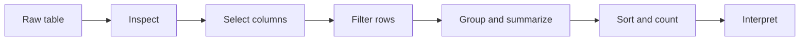
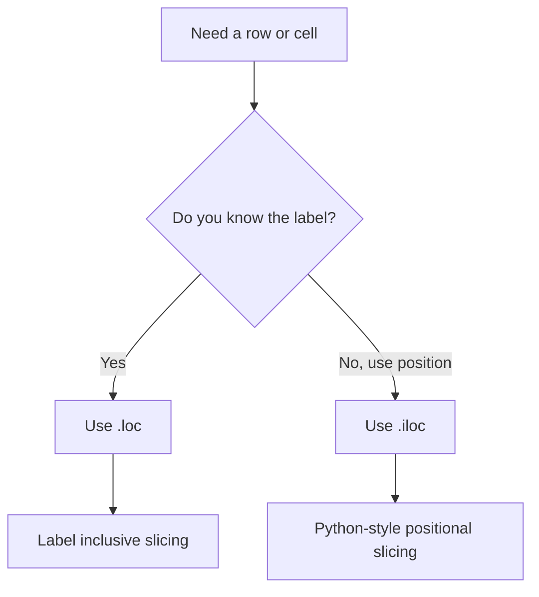

# Data Science Programming — Session 3
## pandas: programmable tables for data analysis

This session introduces pandas as the core tool for tabular data work in Python. The goal is to move from isolated arrays to complete datasets where columns have names, rows have indexes, and every transformation remains written as reproducible code.

> **Core idea:** a pandas workflow lets you inspect, select, filter, group, sort, count, and explain tabular data without losing the history of what you did.



---

## 1. What we will do

The guided notebook follows this route:

| Part | Focus | Main idea |
|---|---|---|
| 1 | `DataFrame` and `Series` | A `DataFrame` is the whole table; a `Series` is one labeled column. |
| 2 | Index | The index is the label of each row, not necessarily its current position. |
| 3 | Opening ritual | Use `head()`, `info()`, and `describe()` before transforming data. |
| 4 | Column selection | One bracket returns a `Series`; two brackets return a `DataFrame`. |
| 5 | `.loc` and `.iloc` | `.loc` selects by label; `.iloc` selects by position. |
| 6 | Boolean filters | Masks keep only the rows that satisfy a condition. |
| 7 | `groupby` | Split the table into groups and summarize each group. |
| 8 | Sort and count | `sort_values()` and `value_counts()` help identify priorities and frequencies. |
| 9 | Real data | The Titanic dataset is used to practice interpretation, with an offline alternative. |

Run the notebook in order with `Shift + Enter` or the play button.

---

## 2. Install and import the libraries

The practice uses pandas and seaborn. If they are not installed in the active environment, run:

```python
%pip install pandas seaborn --quiet
```

Then import pandas with the standard alias:

```python
import pandas as pd
```

The alias `pd` is the conventional name used in pandas documentation and most data analysis projects.

---

## 3. Build a DataFrame

A `DataFrame` can be created from a dictionary. Each key becomes a column name, and each list becomes the values for that column.

```python
import pandas as pd

data = {
    "seller": ["Ana", "Luis", "Sofia"],
    "city": ["Tunja", "Bogota", "Tunja"],
    "category": ["Coffee", "Coffee", "Panela"],
    "units": [120, 340, 90],
    "price": [3500, 3500, 2800]
}

df = pd.DataFrame(data)
df["total"] = df["units"] * df["price"]

df
```

Use this vocabulary from the beginning:

| pandas object | Meaning |
|---|---|
| `DataFrame` | The complete table. |
| `Series` | One column with an index. |
| `index` | The row labels. |
| `columns` | The column labels. |
| `shape` | Number of rows and columns. |

---

## 4. Inspect before transforming

Before filtering, grouping, or changing columns, inspect the table.

```python
print(df.shape)
print(df.columns)
print(df.dtypes)

df.head()
```

Use:

| Method | Use |
|---|---|
| `head()` | See the first rows. |
| `tail()` | See the last rows. |
| `info()` | Check columns, non-null values, and data types. |
| `describe()` | Read numerical summaries. |

This habit avoids many silent mistakes.

---

## 5. Index, labels, and positions

The index is the label of each row. Position is the current order of the row in the table.

```python
by_seller = df.set_index("seller")

print(by_seller.index)
by_seller.head()
```

Selection rules:

```python
by_seller.loc["Ana", "total"]   # label-based access
df.iloc[0, 0]                   # position-based access
```



---

## 6. Select columns

One bracket returns a `Series`; two brackets return a `DataFrame`.

```python
one_column = df["total"]
subset = df[["seller", "city", "total"]]

print(type(one_column))
print(type(subset))
```

If a column name does not exist, pandas raises a `KeyError`. Read the column list before assuming a name:

```python
print(list(df.columns))
```

---

## 7. Filter rows

A condition over a column creates a boolean mask.

```python
high_sales = df[df["total"] >= 500000]
high_sales
```

For compound conditions, use `&`, `|`, `~`, and parentheses:

```python
tunja_coffee = df[(df["city"] == "Tunja") & (df["category"] == "Coffee")]
tunja_coffee
```

With pandas objects, do not use `and` or `or` for row-by-row conditions.

---

## 8. Group, sort, and count

`groupby` separates rows into groups and then applies a summary operation.

```python
sales_by_city = df.groupby("city")["total"].sum()
sales_by_city.sort_values(ascending=False)
```

Common patterns:

```python
df.groupby("category")["units"].sum()
df.groupby("city")["total"].mean()
df["category"].value_counts()
df.sort_values("total", ascending=False)
```

When grouping, choose the column to summarize intentionally. Grouping and averaging every numeric column can produce results that are technically valid but analytically weak.

---

## 9. Real data: Titanic

The notebook uses the Titanic dataset to practice reading real summaries. The point is not the dataset itself; the point is learning to turn table operations into clear interpretations.

```python
import seaborn as sns

titanic = sns.load_dataset("titanic")
titanic.head()
```

Useful questions:

| Question | pandas operation |
|---|---|
| How many rows and columns are there? | `shape` |
| Which columns have missing values? | `info()` or `isna().sum()` |
| What proportion survived? | `value_counts(normalize=True)` |
| How does survival change by class? | `groupby("class")["survived"].mean()` |

---

## 10. Practice notebooks

Download the version that matches your route:

| Notebook | Use it when... |
|---|---|
| Student Practice | You want the guided pandas session with examples, errors to read, and exercises. |
| Advanced Practice | You already handle the basics and want challenges with multi-aggregation, joins, `transform`, pivots, and rolling windows. |

The advanced notebook works with sales and client tables from a grocery distributor in Boyaca. It includes intentionally imperfect joins, grouped comparisons, daily series, moving averages, and peak-day detection.

---

## 11. Before the next session

Complete the assigned practice before Tuesday, September 15, 2026:

| Task | Expected result |
|---|---|
| Grades table | Practice selection, filters, summaries, and grouping on a controlled table. |
| Written answers | Explain what each result means, not only which command produced it. |
| Review | Identify which pandas mistake was easiest to make and how you corrected it. |

---

## Summary

By the end of this session, you should be able to:

- Create and inspect a pandas `DataFrame`.
- Distinguish between `DataFrame`, `Series`, index, label, and position.
- Select columns and rows with brackets, `.loc`, and `.iloc`.
- Filter rows with boolean masks and compound conditions.
- Use `groupby`, `sort_values`, and `value_counts`.
- Read a real dataset and communicate what the summaries mean.
