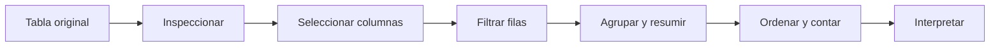
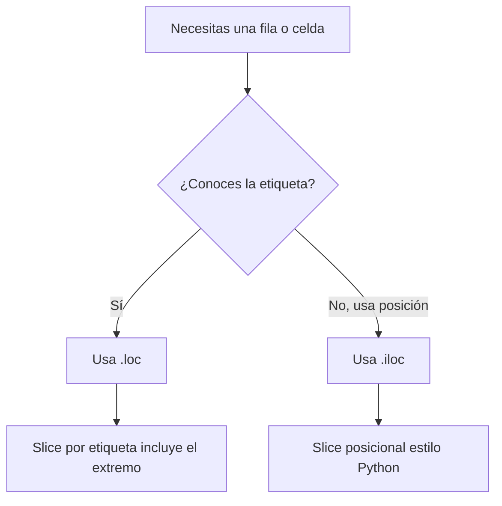

# Data Science Programming — Sesión 3
## pandas: tablas programables para análisis de datos

Esta sesión introduce pandas como herramienta central para trabajar con datos tabulares en Python. El objetivo es pasar de arreglos aislados a conjuntos de datos completos, donde las columnas tienen nombres, las filas tienen índices y cada transformación queda escrita como código reproducible.

> **Idea central:** un flujo con pandas permite inspeccionar, seleccionar, filtrar, agrupar, ordenar, contar y explicar datos tabulares sin perder la memoria de lo que hiciste.



---

## 1. Qué haremos

El notebook guiado sigue esta ruta:

| Parte | Enfoque | Idea principal |
|---|---|---|
| 1 | `DataFrame` y `Series` | Un `DataFrame` es la tabla completa; una `Series` es una columna etiquetada. |
| 2 | Índice | El índice es la etiqueta de cada fila, no necesariamente su posición actual. |
| 3 | Ritual de apertura | Usa `head()`, `info()` y `describe()` antes de transformar datos. |
| 4 | Selección de columnas | Un corchete devuelve una `Series`; dos corchetes devuelven un `DataFrame`. |
| 5 | `.loc` e `.iloc` | `.loc` selecciona por etiqueta; `.iloc` selecciona por posición. |
| 6 | Filtros booleanos | Las máscaras conservan solo las filas que cumplen una condición. |
| 7 | `groupby` | Separar la tabla en grupos y resumir cada grupo. |
| 8 | Ordenar y contar | `sort_values()` y `value_counts()` ayudan a identificar prioridades y frecuencias. |
| 9 | Datos reales | El conjunto Titanic se usa para practicar interpretación, con alternativa sin internet. |

Ejecuta el notebook en orden con `Shift + Enter` o con el botón de reproducción.

---

## 2. Instalar e importar las librerías

La práctica usa pandas y seaborn. Si no están instaladas en el entorno activo, ejecuta:

```python
%pip install pandas seaborn --quiet
```

Después importa pandas con el alias estándar:

```python
import pandas as pd
```

El alias `pd` es el nombre convencional usado en la documentación de pandas y en la mayoría de proyectos de análisis de datos.

---

## 3. Construir un DataFrame

Un `DataFrame` puede crearse desde un diccionario. Cada clave se convierte en nombre de columna y cada lista se convierte en los valores de esa columna.

```python
import pandas as pd

datos = {
    "vendedor": ["Ana", "Luis", "Sofia"],
    "ciudad": ["Tunja", "Bogota", "Tunja"],
    "categoria": ["Cafe", "Cafe", "Panela"],
    "unidades": [120, 340, 90],
    "precio": [3500, 3500, 2800]
}

df = pd.DataFrame(datos)
df["total"] = df["unidades"] * df["precio"]

df
```

Usa este vocabulario desde el comienzo:

| Objeto de pandas | Significado |
|---|---|
| `DataFrame` | La tabla completa. |
| `Series` | Una columna con índice. |
| `index` | Las etiquetas de las filas. |
| `columns` | Las etiquetas de las columnas. |
| `shape` | Número de filas y columnas. |

---

## 4. Inspeccionar antes de transformar

Antes de filtrar, agrupar o cambiar columnas, inspecciona la tabla.

```python
print(df.shape)
print(df.columns)
print(df.dtypes)

df.head()
```

Usa:

| Método | Uso |
|---|---|
| `head()` | Ver las primeras filas. |
| `tail()` | Ver las últimas filas. |
| `info()` | Revisar columnas, valores no nulos y tipos de datos. |
| `describe()` | Leer resúmenes numéricos. |

Este hábito evita muchos errores silenciosos.

---

## 5. Índice, etiquetas y posiciones

El índice es la etiqueta de cada fila. La posición es el orden actual de la fila dentro de la tabla.

```python
por_vendedor = df.set_index("vendedor")

print(por_vendedor.index)
por_vendedor.head()
```

Reglas de selección:

```python
por_vendedor.loc["Ana", "total"]  # acceso por etiqueta
df.iloc[0, 0]                     # acceso por posición
```



---

## 6. Seleccionar columnas

Un corchete devuelve una `Series`; dos corchetes devuelven un `DataFrame`.

```python
una_columna = df["total"]
subconjunto = df[["vendedor", "ciudad", "total"]]

print(type(una_columna))
print(type(subconjunto))
```

Si el nombre de una columna no existe, pandas lanza un `KeyError`. Lee la lista de columnas antes de asumir un nombre:

```python
print(list(df.columns))
```

---

## 7. Filtrar filas

Una condición sobre una columna crea una máscara booleana.

```python
ventas_altas = df[df["total"] >= 500000]
ventas_altas
```

Para condiciones compuestas, usa `&`, `|`, `~` y paréntesis:

```python
cafe_tunja = df[(df["ciudad"] == "Tunja") & (df["categoria"] == "Cafe")]
cafe_tunja
```

Con objetos de pandas, no uses `and` ni `or` para condiciones fila por fila.

---

## 8. Agrupar, ordenar y contar

`groupby` separa las filas en grupos y luego aplica una operación de resumen.

```python
ventas_por_ciudad = df.groupby("ciudad")["total"].sum()
ventas_por_ciudad.sort_values(ascending=False)
```

Patrones comunes:

```python
df.groupby("categoria")["unidades"].sum()
df.groupby("ciudad")["total"].mean()
df["categoria"].value_counts()
df.sort_values("total", ascending=False)
```

Al agrupar, elige con intención la columna que vas a resumir. Agrupar y promediar todas las columnas numéricas puede producir resultados técnicamente válidos, pero analíticamente débiles.

---

## 9. Datos reales: Titanic

El notebook usa el conjunto de datos Titanic para practicar la lectura de resúmenes reales. Lo importante no es el conjunto en sí, sino aprender a convertir operaciones sobre tablas en interpretaciones claras.

```python
import seaborn as sns

titanic = sns.load_dataset("titanic")
titanic.head()
```

Preguntas útiles:

| Pregunta | Operación en pandas |
|---|---|
| ¿Cuántas filas y columnas hay? | `shape` |
| ¿Qué columnas tienen valores faltantes? | `info()` o `isna().sum()` |
| ¿Qué proporción sobrevivió? | `value_counts(normalize=True)` |
| ¿Cómo cambia la supervivencia por clase? | `groupby("class")["survived"].mean()` |

---

## 10. Notebooks de práctica

Descarga la versión que corresponda a tu ruta:

| Notebook | Úsalo cuando... |
|---|---|
| Práctica estudiantes | Quieres la sesión guiada de pandas con ejemplos, errores para leer y ejercicios. |
| Práctica avanzada | Ya manejas lo básico y quieres retos con agregación múltiple, cruces, `transform`, pivotes y ventanas móviles. |

El notebook avanzado trabaja con tablas de ventas y clientes de una distribuidora de abarrotes en Boyacá. Incluye cruces intencionalmente imperfectos, comparaciones por grupo, series diarias, promedios móviles y detección de días pico.

---

## 11. Antes de la siguiente sesión

Completa la práctica asignada antes del martes 15 de septiembre de 2026:

| Tarea | Resultado esperado |
|---|---|
| Tabla de notas | Practicar selección, filtros, resúmenes y agrupación sobre una tabla controlada. |
| Respuestas escritas | Explicar qué significa cada resultado, no solo qué comando lo produjo. |
| Revisión | Identificar qué error de pandas fue más fácil de cometer y cómo lo corregiste. |

---

## Resumen

Al terminar esta sesión, deberías poder:

- Crear e inspeccionar un `DataFrame` de pandas.
- Distinguir entre `DataFrame`, `Series`, índice, etiqueta y posición.
- Seleccionar columnas y filas con corchetes, `.loc` e `.iloc`.
- Filtrar filas con máscaras booleanas y condiciones compuestas.
- Usar `groupby`, `sort_values` y `value_counts`.
- Leer un conjunto de datos real y comunicar qué significan los resúmenes.
