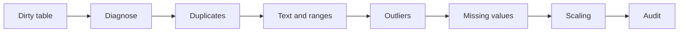

# Data Science Programming — Session 4
## Data cleaning and transformation: diagnose, correct, document

This session focuses on the work that makes analysis trustworthy. Real datasets arrive with missing values, duplicated rows, inconsistent text, impossible ranges, outliers, and columns on incompatible scales. The goal is to clean with an explicit order and defend each decision.

> **Core idea:** cleaning is not cosmetic. Every correction changes the data, so every correction must be visible, reproducible, and justifiable.



---

## 1. What we will do

The guided notebook builds a deliberately dirty sales table and cleans it step by step.

| Part | Focus | Main idea |
|---|---|---|
| 1 | Dirty table | Build a dataset with repeated rows, missing prices, inconsistent text, outliers, and invalid values. |
| 2 | Diagnosis | Inspect shape, types, null values, duplicates, and numerical summaries before changing anything. |
| 3 | Missing values | Compare mean, median, and KNN imputation. |
| 4 | Duplicates | Detect repeated rows and decide what survives. |
| 5 | Text and ranges | Normalize text and identify impossible values. |
| 6 | Outliers | Compare Z-Score and IQR criteria. |
| 7 | Scaling | Use `MinMaxScaler` and `StandardScaler` after cleaning. |
| 8 | Reusable functions | Convert isolated steps into a cleaning pipeline. |
| 9 | Formats | Save and read CSV, JSON, and HDF5. |

This session supports Activity 2, so the important part is not only running commands. You must be able to explain why each cleaning decision is reasonable.

---

## 2. Install and import the libraries

The practice uses pandas, NumPy, scikit-learn, and matplotlib.

```python
%pip install pandas numpy scikit-learn matplotlib --quiet
```

Then import the basic tools:

```python
import pandas as pd
import numpy as np
```

scikit-learn appears later for `KNNImputer`, `MinMaxScaler`, and `StandardScaler`.

---

## 3. Build a dirty table

The notebook creates a small sales dataset by hand. That makes the defects visible and controlled.

```python
ventas = pd.DataFrame({
    "id_venta": [101, 102, 103, 104, 105],
    "vendedor": ["Ana", "luis", "MARTA", " Ana ", "Sofia"],
    "ciudad": ["Tunja", "bogota", "TUNJA", "Tunja ", "Duitama"],
    "unidades": [3, 5, 2, 4, 1],
    "precio": [12000.0, 18000.0, np.nan, 15000.0, 9000.0],
    "calificacion": [5, 4, 3, 5, 4],
})
```

Typical defects:

| Defect | Example |
|---|---|
| Missing values | Empty prices or ratings. |
| Duplicates | A repeated row or repeated sale identifier. |
| Inconsistent text | `Ana`, ` Ana `, `ana`, `MARTA`. |
| Invalid range | A rating of 9 on a 1-to-5 scale. |
| Outlier | A price that is far away from the rest. |

---

## 4. Diagnose before touching

Before cleaning, inspect the table.

```python
print(ventas.shape)
print(ventas.dtypes)
print(ventas.isna().sum())
print(ventas.duplicated().sum())

ventas.describe()
```

Diagnosis questions:

| Question | Command |
|---|---|
| How large is the table? | `df.shape` |
| What types does it contain? | `df.dtypes` or `df.info()` |
| How many missing values are there? | `df.isna().sum()` |
| Are there repeated rows? | `df.duplicated().sum()` |
| Do the numbers make sense? | `df.describe()` |

---

## 5. Missing values

Missing values can be filled in several ways, but the method must match the context.

```python
media = ventas["precio"].mean()
mediana = ventas["precio"].median()

con_media = ventas.copy()
con_mediana = ventas.copy()

con_media["precio"] = con_media["precio"].fillna(media)
con_mediana["precio"] = con_mediana["precio"].fillna(mediana)
```

Mean is sensitive to outliers. Median is usually more robust when prices are skewed.

KNN imputation can estimate missing values from neighboring rows, but it should be used after treating extreme values:

```python
from sklearn.impute import KNNImputer

imputer = KNNImputer(n_neighbors=3)
numeric = ventas[["unidades", "precio", "calificacion"]]
completed = imputer.fit_transform(numeric)
```

---

## 6. Duplicates, text, and ranges

Repeated rows can be counted and removed:

```python
print(ventas.duplicated().sum())
ventas_sin_duplicados = ventas.drop_duplicates(keep="first")
```

Text columns should be normalized before grouping or comparing:

```python
ventas["vendedor_limpio"] = (
    ventas["vendedor"]
    .str.strip()
    .str.lower()
    .str.title()
)
```

Invalid ranges should be detected with masks:

```python
fuera_rango = (ventas["calificacion"] < 1) | (ventas["calificacion"] > 5)
ventas.loc[fuera_rango, "calificacion"] = np.nan
```

---

## 7. Outliers: Z-Score and IQR

Two common criteria:

| Method | Rule | Use it when... |
|---|---|---|
| Z-Score | `abs(x - mean) / std > 3` | The distribution is approximately normal. |
| IQR | Outside `[Q1 - 1.5*IQR, Q3 + 1.5*IQR]` | The distribution is skewed or has strong extremes. |

```python
q1 = ventas["precio"].quantile(0.25)
q3 = ventas["precio"].quantile(0.75)
iqr = q3 - q1

outliers_iqr = (ventas["precio"] < q1 - 1.5 * iqr) | (ventas["precio"] > q3 + 1.5 * iqr)
ventas[outliers_iqr]
```

The method is a decision. The notebook asks you to compare both criteria and defend which one fits the data better.

---

## 8. Scaling

Scaling puts numeric columns on comparable ranges. It does not fix bad data.

```python
from sklearn.preprocessing import MinMaxScaler, StandardScaler

cols = ["precio"]

minmax = MinMaxScaler()
standard = StandardScaler()

ventas["precio_minmax"] = minmax.fit_transform(ventas[cols])
ventas["precio_z"] = standard.fit_transform(ventas[cols])
```

Important warnings:

1. Treat outliers before scaling.
2. In modeling workflows, fit scalers on training data and transform test data later.

---

## 9. Reusable cleaning functions

The notebook moves from isolated commands to functions.

```python
def normalizar_texto(serie):
    return serie.str.strip().str.lower().str.title()

def limpiar_ventas(df):
    limpio = df.copy()
    limpio = limpio.drop_duplicates()
    limpio["vendedor"] = normalizar_texto(limpio["vendedor"])
    limpio["ciudad"] = normalizar_texto(limpio["ciudad"])
    return limpio
```

Good cleaning functions:

| Rule | Meaning |
|---|---|
| Do not modify input directly | Start with `df.copy()`. |
| Make decisions explicit | Use clear parameters and names. |
| Audit the result | Check missing values, duplicates, ranges, and summaries again. |

---

## 10. Practice notebooks

Download the version that matches your route:

| Notebook | Use it when... |
|---|---|
| Student Practice | You want the guided session with diagnosis, imputation, duplicates, outliers, scaling, and reusable functions. |
| Advanced Practice | You already handle the basics and want parameterized outlier detection, robust text normalization, group-wise imputation, and composable validation. |

The advanced notebook works with a dirty sales table from Boyaca and asks you to build tools that can be reused beyond one specific dataset.

---

## 11. Before the next session

Complete the assigned practice before Tuesday, September 22, 2026:

| Task | Expected result |
|---|---|
| Activity 2 preparation | Show diagnosis, cleaning decisions, and final audit. |
| Written justification | Explain when you used mean, median, KNN, Z-Score, IQR, MinMax, or StandardScaler. |
| Reusable code | Package your cleaning steps in functions that can run again. |

---

## Summary

By the end of this session, you should be able to:

- Diagnose missing values, duplicates, inconsistent text, impossible values, and outliers.
- Choose between mean, median, KNN, Z-Score, IQR, MinMaxScaler, and StandardScaler.
- Explain why cleaning order matters.
- Write reusable cleaning functions and audit the final result.
- Save and read data in CSV, JSON, and HDF5 formats.
