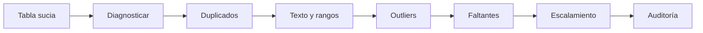

# Data Science Programming — Sesión 4
## Limpieza y transformación de datos: diagnosticar, corregir, documentar

Esta sesión se concentra en el trabajo que hace confiable un análisis. Los datos reales llegan con valores faltantes, filas duplicadas, texto inconsistente, rangos imposibles, outliers y columnas en escalas incompatibles. El objetivo es limpiar con un orden explícito y defender cada decisión.

> **Idea central:** limpiar datos no es un asunto cosmético. Cada corrección cambia los datos, por eso debe ser visible, reproducible y justificable.



---

## 1. Qué haremos

El notebook guiado construye una tabla de ventas deliberadamente sucia y la limpia paso a paso.

| Parte | Enfoque | Idea principal |
|---|---|---|
| 1 | Tabla sucia | Construir un conjunto con filas repetidas, precios faltantes, texto inconsistente, outliers y valores inválidos. |
| 2 | Diagnóstico | Revisar forma, tipos, nulos, duplicados y resúmenes numéricos antes de cambiar algo. |
| 3 | Valores faltantes | Comparar imputación con media, mediana y KNN. |
| 4 | Duplicados | Detectar filas repetidas y decidir cuál sobrevive. |
| 5 | Texto y rangos | Normalizar texto e identificar valores imposibles. |
| 6 | Outliers | Comparar los criterios Z-Score e IQR. |
| 7 | Escalamiento | Usar `MinMaxScaler` y `StandardScaler` después de limpiar. |
| 8 | Funciones reutilizables | Convertir pasos aislados en un pipeline de limpieza. |
| 9 | Formatos | Guardar y leer CSV, JSON y HDF5. |

Esta sesión sostiene la Actividad 2, así que lo importante no es solo ejecutar comandos. Debes poder explicar por qué cada decisión de limpieza es razonable.

---

## 2. Instalar e importar las librerías

La práctica usa pandas, NumPy, scikit-learn y matplotlib.

```python
%pip install pandas numpy scikit-learn matplotlib --quiet
```

Después importa las herramientas básicas:

```python
import pandas as pd
import numpy as np
```

scikit-learn aparece más adelante para `KNNImputer`, `MinMaxScaler` y `StandardScaler`.

---

## 3. Construir una tabla sucia

El notebook crea a mano un pequeño conjunto de ventas. Así los defectos quedan visibles y controlados.

```python
ventas = pd.DataFrame({
    "id_venta": [101, 102, 103, 104, 105],
    "vendedor": ["Ana", "luis", "MARTA", " Ana ", "Sofia"],
    "ciudad": ["Tunja", "bogota", "TUNJA", "Tunja ", "Duitama"],
    "unidades": [3, 5, 2, 4, 1],
    "precio": [12000.0, 18000.0, np.nan, 15000.0, 9000.0],
    "calificacion": [5, 4, 3, 5, 4],
})
```

Defectos típicos:

| Defecto | Ejemplo |
|---|---|
| Valores faltantes | Precios o calificaciones vacías. |
| Duplicados | Una fila repetida o un identificador de venta repetido. |
| Texto inconsistente | `Ana`, ` Ana `, `ana`, `MARTA`. |
| Rango inválido | Una calificación de 9 en escala de 1 a 5. |
| Outlier | Un precio muy alejado del resto. |

---

## 4. Diagnosticar antes de tocar

Antes de limpiar, inspecciona la tabla.

```python
print(ventas.shape)
print(ventas.dtypes)
print(ventas.isna().sum())
print(ventas.duplicated().sum())

ventas.describe()
```

Preguntas de diagnóstico:

| Pregunta | Comando |
|---|---|
| ¿Qué tamaño tiene la tabla? | `df.shape` |
| ¿Qué tipos contiene? | `df.dtypes` o `df.info()` |
| ¿Cuántos valores faltantes hay? | `df.isna().sum()` |
| ¿Hay filas repetidas? | `df.duplicated().sum()` |
| ¿Los números tienen sentido? | `df.describe()` |

---

## 5. Valores faltantes

Los valores faltantes se pueden completar de varias formas, pero el método debe corresponder al contexto.

```python
media = ventas["precio"].mean()
mediana = ventas["precio"].median()

con_media = ventas.copy()
con_mediana = ventas.copy()

con_media["precio"] = con_media["precio"].fillna(media)
con_mediana["precio"] = con_mediana["precio"].fillna(mediana)
```

La media es sensible a los outliers. La mediana suele ser más robusta cuando los precios están sesgados.

La imputación KNN puede estimar valores faltantes desde filas vecinas, pero conviene usarla después de tratar valores extremos:

```python
from sklearn.impute import KNNImputer

imputador = KNNImputer(n_neighbors=3)
numericas = ventas[["unidades", "precio", "calificacion"]]
completas = imputador.fit_transform(numericas)
```

---

## 6. Duplicados, texto y rangos

Las filas repetidas se pueden contar y eliminar:

```python
print(ventas.duplicated().sum())
ventas_sin_duplicados = ventas.drop_duplicates(keep="first")
```

Las columnas de texto deben normalizarse antes de agrupar o comparar:

```python
ventas["vendedor_limpio"] = (
    ventas["vendedor"]
    .str.strip()
    .str.lower()
    .str.title()
)
```

Los rangos inválidos deben detectarse con máscaras:

```python
fuera_rango = (ventas["calificacion"] < 1) | (ventas["calificacion"] > 5)
ventas.loc[fuera_rango, "calificacion"] = np.nan
```

---

## 7. Outliers: Z-Score e IQR

Dos criterios comunes:

| Método | Regla | Úsalo cuando... |
|---|---|---|
| Z-Score | `abs(x - media) / desviación > 3` | La distribución es aproximadamente normal. |
| IQR | Fuera de `[Q1 - 1.5*IQR, Q3 + 1.5*IQR]` | La distribución es sesgada o tiene extremos fuertes. |

```python
q1 = ventas["precio"].quantile(0.25)
q3 = ventas["precio"].quantile(0.75)
iqr = q3 - q1

outliers_iqr = (ventas["precio"] < q1 - 1.5 * iqr) | (ventas["precio"] > q3 + 1.5 * iqr)
ventas[outliers_iqr]
```

El método es una decisión. El notebook te pide comparar ambos criterios y defender cuál se ajusta mejor a los datos.

---

## 8. Escalamiento

Escalar pone columnas numéricas en rangos comparables. No arregla datos malos.

```python
from sklearn.preprocessing import MinMaxScaler, StandardScaler

cols = ["precio"]

minmax = MinMaxScaler()
standard = StandardScaler()

ventas["precio_minmax"] = minmax.fit_transform(ventas[cols])
ventas["precio_z"] = standard.fit_transform(ventas[cols])
```

Advertencias importantes:

1. Trata los outliers antes de escalar.
2. En flujos de modelado, ajusta los escaladores con datos de entrenamiento y transforma los datos de prueba después.

---

## 9. Funciones reutilizables

El notebook pasa de comandos aislados a funciones.

```python
def normalizar_texto(serie):
    return serie.str.strip().str.lower().str.title()

def limpiar_ventas(df):
    limpio = df.copy()
    limpio = limpio.drop_duplicates()
    limpio["vendedor"] = normalizar_texto(limpio["vendedor"])
    limpio["ciudad"] = normalizar_texto(limpio["ciudad"])
    return limpio
```

Buenas funciones de limpieza:

| Regla | Significado |
|---|---|
| No modificar directamente la entrada | Empezar con `df.copy()`. |
| Hacer explícitas las decisiones | Usar parámetros y nombres claros. |
| Auditar el resultado | Revisar de nuevo faltantes, duplicados, rangos y resúmenes. |

---

## 10. Notebooks de práctica

Descarga la versión que corresponda a tu ruta:

| Notebook | Úsalo cuando... |
|---|---|
| Práctica estudiantes | Quieres la sesión guiada con diagnóstico, imputación, duplicados, outliers, escalamiento y funciones reutilizables. |
| Práctica avanzada | Ya manejas lo básico y quieres detección parametrizada de outliers, normalización robusta de texto, imputación por grupo y validación componible. |

El notebook avanzado trabaja con una tabla sucia de ventas de Boyacá y pide construir herramientas que se puedan reutilizar más allá de un conjunto específico.

---

## 11. Antes de la siguiente sesión

Completa la práctica asignada antes del martes 22 de septiembre de 2026:

| Tarea | Resultado esperado |
|---|---|
| Preparación de la Actividad 2 | Mostrar diagnóstico, decisiones de limpieza y auditoría final. |
| Justificación escrita | Explicar cuándo usaste media, mediana, KNN, Z-Score, IQR, MinMax o StandardScaler. |
| Código reutilizable | Empaquetar los pasos de limpieza en funciones que puedan ejecutarse de nuevo. |

---

## Resumen

Al terminar esta sesión, deberías poder:

- Diagnosticar valores faltantes, duplicados, texto inconsistente, valores imposibles y outliers.
- Elegir entre media, mediana, KNN, Z-Score, IQR, MinMaxScaler y StandardScaler.
- Explicar por qué importa el orden de limpieza.
- Escribir funciones reutilizables de limpieza y auditar el resultado final.
- Guardar y leer datos en formatos CSV, JSON y HDF5.
