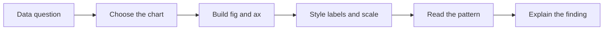
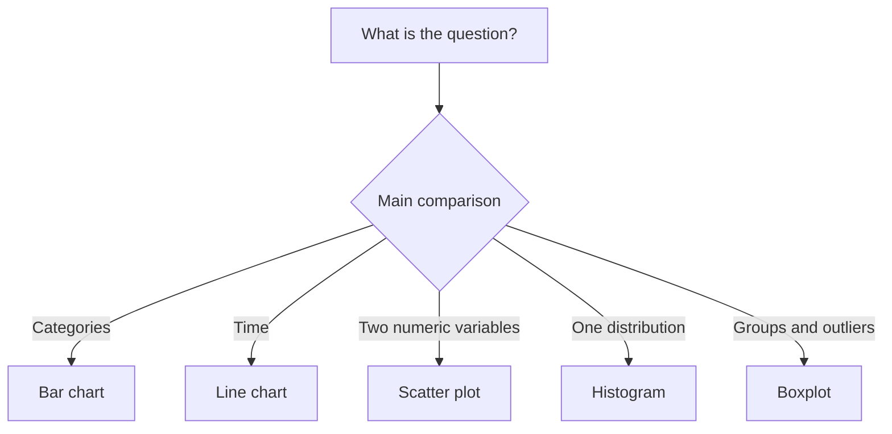

# Data Science Programming — Session 5
## Matplotlib and Seaborn: choose, build, read, and explain charts

This session turns data tables into visual evidence. The goal is not only to draw charts, but to choose the correct chart for the question, control the figure with `fig` and `ax`, and explain what the graph does and does not support.

> **Core idea:** a chart is an analytical argument. It must be readable, honest, reproducible, and connected to a specific question.



---

## 1. What we will do

The guided notebook moves from first plots to critical interpretation.

| Part | Focus | Main idea |
|---|---|---|
| 1 | Anscombe's quartet | Similar summary statistics can hide very different patterns. |
| 2 | Figure anatomy | Use `fig, ax = plt.subplots()` to control the figure explicitly. |
| 3 | Five essential charts | Match bars, lines, scatter plots, histograms, and boxplots to questions. |
| 4 | Customization | Add titles, labels, legends, colors, annotations, and readable formatting. |
| 5 | Grouped data | Move from `groupby` summaries to visual comparison. |
| 6 | Seaborn | Use concise statistical graphics on top of Matplotlib. |
| 7 | Full story | Combine chart choice and interpretation into a responsible visual explanation. |

The advanced notebook follows the same topic, but asks you to return and inspect `Figure` and `Axes` objects so plots can be tested with assertions.

---

## 2. Install and import the libraries

The practice uses Matplotlib, Seaborn, pandas, and NumPy.

```python
%pip install matplotlib seaborn pandas numpy --quiet
```

Then import the core tools:

```python
import matplotlib
import matplotlib.pyplot as plt
import seaborn as sns
import pandas as pd
import numpy as np

print("matplotlib", matplotlib.__version__)
print("seaborn   ", sns.__version__)
print("pandas    ", pd.__version__)
```

In notebooks, run the cells in order. A plotting cell often depends on the dataset, summary table, or function created above it.

---

## 3. Why visualization matters

Anscombe's quartet shows why numerical summaries are not enough. Four datasets can share similar means, standard deviations, correlations, and regression lines while showing different visual structures.

```python
summary = anscombe.groupby("group").agg(
    mean_x=("x", "mean"),
    mean_y=("y", "mean"),
    std_x=("x", "std"),
    std_y=("y", "std"),
)
print(summary.round(2))
```

The lesson is practical: before making a conclusion, look at the data.

```python
fig, axes = plt.subplots(2, 2, figsize=(8, 6), sharex=True, sharey=True)

for ax, (group, data) in zip(axes.ravel(), anscombe.groupby("group")):
    ax.scatter(data["x"], data["y"])
    ax.set_title(f"Group {group}")

fig.suptitle("Anscombe's quartet")
plt.show()
```

---

## 4. Figure anatomy: `fig` and `ax`

Matplotlib separates the full canvas from the plotting area.

| Object | Meaning |
|---|---|
| `Figure` | The complete canvas. It controls size, layout, and saving. |
| `Axes` | One plotting region inside a figure. This is where data is drawn. |
| `Axis` | The X or Y scale inside an `Axes`: limits, ticks, labels, and formatting. |
| `fig, ax = plt.subplots()` | The recommended starting point for one chart. |
| `plt.subplots(2, 2)` | Creates a grid of charts in one figure. |

Prefer explicit `Axes` methods:

```python
fig, ax = plt.subplots(figsize=(7, 4))
ax.plot(meses, ventas, marker="o")
ax.set_title("Monthly sales")
ax.set_xlabel("Month")
ax.set_ylabel("Sales")
plt.show()
```

This style keeps control when the figure has several panels.

---

## 5. Choose the chart from the question

The chart type should come from the analytical question, not from decoration.

| Question | Chart | Method |
|---|---|---|
| How do categories compare? | Bar chart | `ax.bar()` or `sns.barplot()` |
| How does a value change over time? | Line chart | `ax.plot()` or `sns.lineplot()` |
| How are two numeric variables related? | Scatter plot | `ax.scatter()` or `sns.scatterplot()` |
| How is one numeric variable distributed? | Histogram | `ax.hist()` or `sns.histplot()` |
| How do distributions compare by group? | Boxplot | `ax.boxplot()` or `sns.boxplot()` |



---

## 6. Make the figure readable

A chart is not finished when Python draws it. It needs enough context for another person to read it without guessing.

```python
fig, ax = plt.subplots(figsize=(8, 4.5))
bars = ax.bar(ciudades, ingresos, color="#62f7ff", label="Revenue")

ax.set_title("Revenue by city - first semester 2026")
ax.set_xlabel("City")
ax.set_ylabel("Revenue (COP)")
ax.bar_label(bars, fmt="{:,.0f}", padding=3)
ax.legend()
plt.xticks(rotation=25, ha="right")
plt.tight_layout()
plt.show()
```

Common mistakes:

| Mistake | Correction |
|---|---|
| Calling `bar_label` with the data instead of the bars | Store the result of `ax.bar(...)` and pass that object to `ax.bar_label(...)`. |
| Leaving labels empty | Always name axes and units. |
| Using unreadable ticks | Rotate, shorten, or format tick labels. |
| Adding style before understanding the data | Decide the message first, then refine the presentation. |

---

## 7. From `groupby` to a chart

Many useful charts start with a summary table.

```python
resumen = (
    titanic
    .groupby("pclass", as_index=False)
    .agg(supervivencia=("survived", "mean"))
)

fig, ax = plt.subplots(figsize=(7, 4))
ax.bar(resumen["pclass"], resumen["supervivencia"])
ax.set_title("Survival rate by passenger class")
ax.set_xlabel("Passenger class")
ax.set_ylabel("Survival rate")
plt.show()
```

Read the chart in words:

1. What is being compared?
2. Which group is higher or lower?
3. How large is the difference?
4. What cannot be concluded from this chart alone?

---

## 8. Seaborn for statistical visualization

Seaborn works on top of Matplotlib and reduces repeated code for statistical plots.

```python
fig, ax = plt.subplots(figsize=(7, 4))
sns.boxplot(data=titanic, x="pclass", y="fare", ax=ax)
ax.set_title("Fare distribution by passenger class")
ax.set_xlabel("Passenger class")
ax.set_ylabel("Fare")
plt.show()
```

It is still useful to keep the `Axes` object:

```python
fig, ax = plt.subplots(figsize=(5.5, 4.5))
sns.heatmap(corr, annot=True, fmt=".2f", cmap="coolwarm", vmin=-1, vmax=1, ax=ax)
ax.set_title("Correlation between numeric variables")
plt.show()
```

Column names must be exact. If the DataFrame has `survived`, `Survived` and `survival` are different names.

---

## 9. Practice notebooks

Download the version that matches your route:

| Notebook | Use it when... |
|---|---|
| Student Practice | You want the guided route through Anscombe's quartet, `fig` and `ax`, five core charts, Titanic summaries, Seaborn, and interpretation. |
| Advanced Practice | You already handle the basics and want object-oriented Matplotlib challenges with exact contracts, assertions, reusable themes, Pareto charts, and multi-axis panels. |

The advanced notebook is intentionally strict: it asks functions to return `(fig, ax)` so charts can be inspected, reused, saved, and tested.

---

## 10. Before the next session

Prepare five charts for a dataset related to your project or activity.

| Requirement | Minimum expectation |
|---|---|
| Comparison | One bar chart with a clear category comparison. |
| Trend | One line chart if the data has time or ordered stages. |
| Relationship | One scatter plot between two numeric variables. |
| Distribution | One histogram or boxplot. |
| Interpretation | Each chart must include two or three sentences explaining the finding and one limitation. |

---

## 11. Summary

Three rules to keep:

1. Choose the chart from the question.
2. Use `fig, ax = plt.subplots()` when you want control.
3. Interpret the visual pattern without overstating what the chart proves.

Visualization is part of the analysis, not decoration added at the end.
