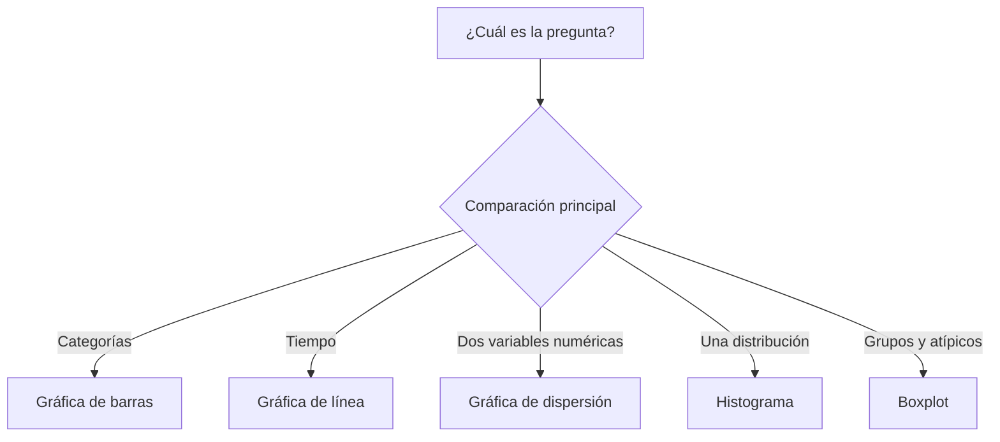

# Data Science Programming — Sesión 5
## Matplotlib y Seaborn: elegir, construir, leer y explicar gráficas

Esta sesión convierte tablas de datos en evidencia visual. El objetivo no es solo dibujar gráficas, sino escoger la gráfica correcta para la pregunta, controlar la figura con `fig` y `ax`, y explicar qué sostiene la visualización y qué no permite concluir.

> **Idea central:** una gráfica es un argumento analítico. Debe ser legible, honesta, reproducible y estar conectada con una pregunta específica.


---

## 1. Qué haremos

El notebook guiado avanza desde las primeras gráficas hasta la interpretación crítica.

| Parte | Enfoque | Idea principal |
|---|---|---|
| 1 | Cuarteto de Anscombe | Estadísticas similares pueden ocultar patrones muy distintos. |
| 2 | Anatomía de una figura | Usar `fig, ax = plt.subplots()` para controlar la figura de manera explícita. |
| 3 | Cinco gráficas esenciales | Relacionar barras, líneas, dispersión, histogramas y boxplots con preguntas. |
| 4 | Personalización | Agregar títulos, etiquetas, leyendas, colores, anotaciones y formatos legibles. |
| 5 | Datos agrupados | Pasar de resúmenes con `groupby` a comparaciones visuales. |
| 6 | Seaborn | Usar gráficas estadísticas concisas sobre Matplotlib. |
| 7 | Historia completa | Combinar selección de gráfica e interpretación en una explicación visual responsable. |

El notebook avanzado trabaja el mismo tema, pero exige devolver e inspeccionar objetos `Figure` y `Axes` para que las gráficas puedan verificarse con `assert`.

---

## 2. Instalar e importar las librerías

La práctica usa Matplotlib, Seaborn, pandas y NumPy.

```python
%pip install matplotlib seaborn pandas numpy --quiet
```

Después importa las herramientas centrales:

```python
import matplotlib
import matplotlib.pyplot as plt
import seaborn as sns
import pandas as pd
import numpy as np

print("matplotlib", matplotlib.__version__)
print("seaborn   ", sns.__version__)
print("pandas    ", pd.__version__)
```

En notebooks, ejecuta las celdas en orden. Una celda de gráfica suele depender del conjunto de datos, la tabla resumen o la función creada antes.

---

## 3. Por qué importa visualizar

El cuarteto de Anscombe muestra por qué los resúmenes numéricos no bastan. Cuatro conjuntos pueden compartir medias, desviaciones estándar, correlaciones y líneas de regresión similares, pero mostrar estructuras visuales diferentes.

```python
resumen = anscombe.groupby("grupo").agg(
    media_x=("x", "mean"),
    media_y=("y", "mean"),
    desv_x=("x", "std"),
    desv_y=("y", "std"),
)
print(resumen.round(2))
```

La lección es práctica: antes de concluir, mira los datos.

```python
fig, axes = plt.subplots(2, 2, figsize=(8, 6), sharex=True, sharey=True)

for ax, (grupo, datos) in zip(axes.ravel(), anscombe.groupby("grupo")):
    ax.scatter(datos["x"], datos["y"])
    ax.set_title(f"Grupo {grupo}")

fig.suptitle("Cuarteto de Anscombe")
plt.show()
```

---

## 4. Anatomía de una figura: `fig` y `ax`

Matplotlib separa el lienzo completo del área donde se dibujan los datos.

| Objeto | Significado |
|---|---|
| `Figure` | El lienzo completo. Controla tamaño, distribución y guardado. |
| `Axes` | Una región de gráfica dentro de una figura. Allí se dibujan los datos. |
| `Axis` | El eje X o Y dentro de un `Axes`: límites, marcas, etiquetas y formato. |
| `fig, ax = plt.subplots()` | El punto de partida recomendado para una gráfica. |
| `plt.subplots(2, 2)` | Crea una cuadrícula de gráficas en una sola figura. |

Prefiere métodos explícitos del `Axes`:

```python
fig, ax = plt.subplots(figsize=(7, 4))
ax.plot(meses, ventas, marker="o")
ax.set_title("Ventas mensuales")
ax.set_xlabel("Mes")
ax.set_ylabel("Ventas")
plt.show()
```

Este estilo mantiene el control cuando la figura tiene varios paneles.

---

## 5. Elegir la gráfica desde la pregunta

El tipo de gráfica debe salir de la pregunta analítica, no de la decoración.

| Pregunta | Gráfica | Método |
|---|---|---|
| ¿Cómo se comparan las categorías? | Barras | `ax.bar()` o `sns.barplot()` |
| ¿Cómo cambia un valor en el tiempo? | Línea | `ax.plot()` o `sns.lineplot()` |
| ¿Cómo se relacionan dos variables numéricas? | Dispersión | `ax.scatter()` o `sns.scatterplot()` |
| ¿Cómo se distribuye una variable numérica? | Histograma | `ax.hist()` o `sns.histplot()` |
| ¿Cómo se comparan distribuciones por grupo? | Boxplot | `ax.boxplot()` o `sns.boxplot()` |



---

## 6. Hacer legible la figura

Una gráfica no está terminada cuando Python la dibuja. Necesita suficiente contexto para que otra persona pueda leerla sin adivinar.

```python
fig, ax = plt.subplots(figsize=(8, 4.5))
barras = ax.bar(ciudades, ingresos, color="#62f7ff", label="Ingresos")

ax.set_title("Ingresos por ciudad - primer semestre 2026")
ax.set_xlabel("Ciudad")
ax.set_ylabel("Ingresos (COP)")
ax.bar_label(barras, fmt="{:,.0f}", padding=3)
ax.legend()
plt.xticks(rotation=25, ha="right")
plt.tight_layout()
plt.show()
```

Errores comunes:

| Error | Corrección |
|---|---|
| Llamar `bar_label` con los datos en vez de las barras | Guardar el resultado de `ax.bar(...)` y pasar ese objeto a `ax.bar_label(...)`. |
| Dejar etiquetas vacías | Nombrar siempre los ejes y las unidades. |
| Usar marcas ilegibles | Rotar, acortar o formatear las etiquetas de los ejes. |
| Agregar estilo antes de entender los datos | Decidir primero el mensaje y después refinar la presentación. |

---

## 7. Del `groupby` a la gráfica

Muchas gráficas útiles empiezan con una tabla resumen.

```python
resumen = (
    titanic
    .groupby("pclass", as_index=False)
    .agg(supervivencia=("survived", "mean"))
)

fig, ax = plt.subplots(figsize=(7, 4))
ax.bar(resumen["pclass"], resumen["supervivencia"])
ax.set_title("Tasa de supervivencia por clase")
ax.set_xlabel("Clase del pasajero")
ax.set_ylabel("Tasa de supervivencia")
plt.show()
```

Lee la gráfica en voz alta:

1. ¿Qué se está comparando?
2. ¿Qué grupo está más alto o más bajo?
3. ¿Qué tan grande es la diferencia?
4. ¿Qué no se puede concluir solo con esta gráfica?

---

## 8. Seaborn para visualización estadística

Seaborn funciona sobre Matplotlib y reduce código repetido en gráficas estadísticas.

```python
fig, ax = plt.subplots(figsize=(7, 4))
sns.boxplot(data=titanic, x="pclass", y="fare", ax=ax)
ax.set_title("Distribución de tarifa por clase")
ax.set_xlabel("Clase del pasajero")
ax.set_ylabel("Tarifa")
plt.show()
```

Sigue siendo útil conservar el objeto `Axes`:

```python
fig, ax = plt.subplots(figsize=(5.5, 4.5))
sns.heatmap(corr, annot=True, fmt=".2f", cmap="coolwarm", vmin=-1, vmax=1, ax=ax)
ax.set_title("Correlación entre variables numéricas")
plt.show()
```

Los nombres de columna deben ser exactos. Si el DataFrame tiene `survived`, `Survived` y `survival` son nombres diferentes.

---

## 9. Notebooks de práctica

Descarga la versión que corresponda a tu ruta:

| Notebook | Úsalo cuando... |
|---|---|
| Práctica estudiantes | Quieres la ruta guiada por el cuarteto de Anscombe, `fig` y `ax`, cinco gráficas centrales, resúmenes del Titanic, Seaborn e interpretación. |
| Práctica avanzada | Ya manejas lo básico y quieres retos de Matplotlib orientado a objetos con contratos exactos, `assert`, temas reutilizables, diagramas de Pareto y paneles con varios ejes. |

El notebook avanzado es intencionalmente estricto: pide que las funciones devuelvan `(fig, ax)` para que las gráficas puedan inspeccionarse, reutilizarse, guardarse y probarse.

---

## 10. Antes de la próxima sesión

Prepara cinco gráficas para un conjunto de datos relacionado con tu proyecto o actividad.

| Requisito | Expectativa mínima |
|---|---|
| Comparación | Una gráfica de barras con una comparación clara entre categorías. |
| Tendencia | Una gráfica de línea si los datos tienen tiempo o etapas ordenadas. |
| Relación | Una gráfica de dispersión entre dos variables numéricas. |
| Distribución | Un histograma o un boxplot. |
| Interpretación | Cada gráfica debe incluir dos o tres frases que expliquen el hallazgo y una limitación. |

---

## 11. Resumen

Tres reglas para conservar:

1. Elige la gráfica desde la pregunta.
2. Usa `fig, ax = plt.subplots()` cuando necesites control.
3. Interpreta el patrón visual sin exagerar lo que la gráfica demuestra.

La visualización hace parte del análisis; no es decoración agregada al final.
