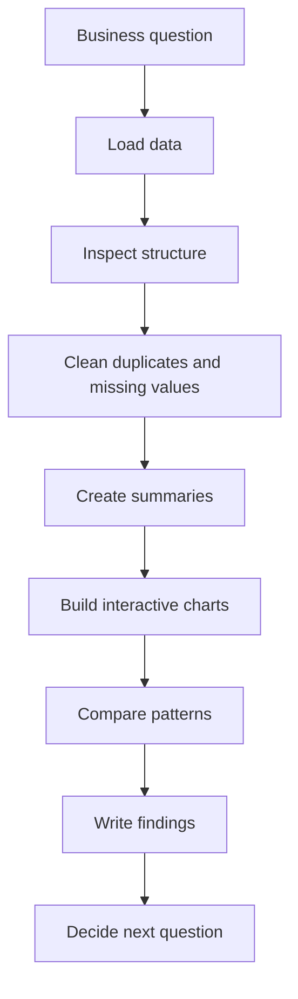
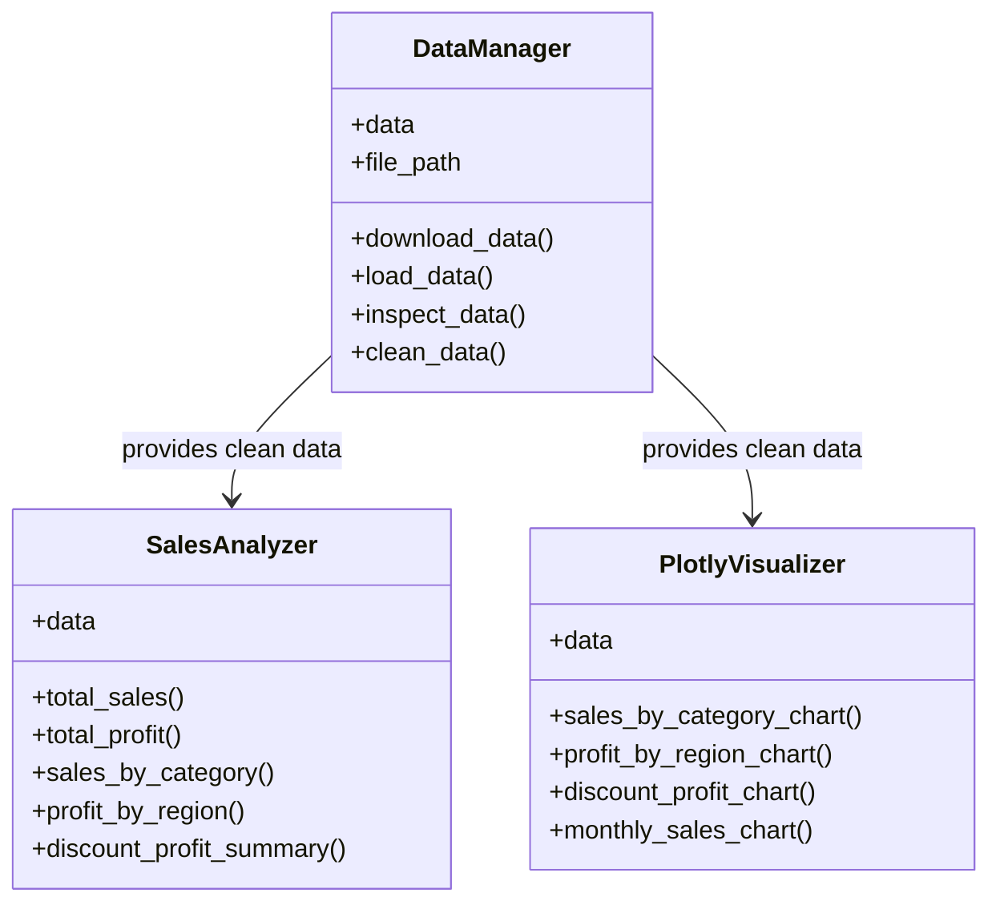
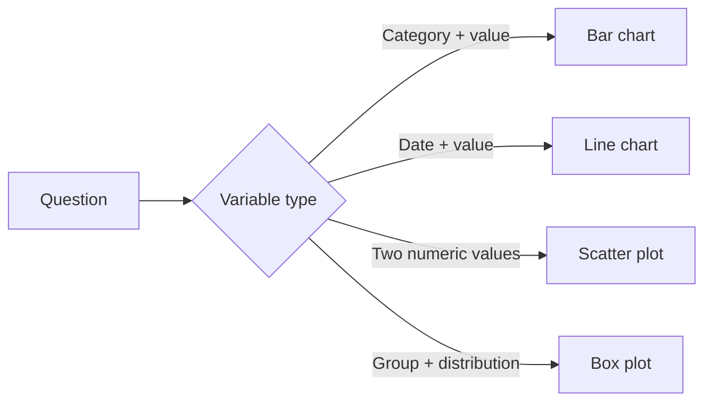

# Session 06 · Plotly, EDA, and the Supermart project

This session connects exploratory data analysis with an organized Python project. The working context is the **Supermart Grocery Sales** dataset and the project repository:

[https://github.com/DIALVEBE/supermart-poo](https://github.com/DIALVEBE/supermart-poo)

The goal is not only to draw charts. The goal is to ask clear questions, prepare trustworthy data, create interactive visualizations with Plotly, and explain findings in a way another person can understand.

<div class="callout callout-primary" markdown="1">

**Session outcome:** by the end, you should be able to read the Supermart project structure, run an EDA workflow, build interactive charts, and connect those charts with short analytical conclusions.

</div>

## Learning Goals

- Understand the role of EDA before building conclusions.
- Use Plotly Express to create interactive charts.
- Compare sales, profit, discounts, categories, regions, and dates.
- Separate data loading, analysis, and visualization responsibilities.
- Interpret charts with evidence instead of guessing from isolated values.

## Working Project

The session uses a public repository as the base project:

```bash
git clone https://github.com/DIALVEBE/supermart-poo.git
cd supermart-poo
```

If the repository includes a `README.md`, read it first and follow its environment instructions. The expected data work uses these Python libraries:

```bash
python -m pip install pandas plotly kagglehub
```

If you use `uv`, the equivalent installation is:

```bash
uv add pandas plotly kagglehub
```

## Dataset Context

The project works with **Supermart Grocery Sales - Retail Analytics Dataset**, a retail sales dataset available on Kaggle. Useful columns for this session include:

| Column | Why it matters |
|---|---|
| `Category` | Compares product groups. |
| `Sub Category` | Provides more detail inside each category. |
| `Region` | Compares geographical performance. |
| `Order Date` | Enables time-based analysis. |
| `Sales` | Measures revenue volume. |
| `Discount` | Helps evaluate price reductions. |
| `Profit` | Measures financial result. |

The first analytical decision is to focus on a manageable group of variables. More columns do not automatically produce better analysis.

## EDA Workflow

Exploratory data analysis moves from context to evidence. A useful workflow is:



Each chart should answer one question. If a chart does not support a question, it is probably decoration.

## Questions for the Analysis

Use the project to answer questions such as:

1. What is the total sales value?
2. What is the total profit?
3. Which category sells the most?
4. Which category generates the most profit?
5. Which region has the highest sales?
6. Which region has the highest profit?
7. Is there a visible relationship between discounts and profit?
8. Do sales or profit change over time?

These questions are intentionally simple. Good EDA starts with simple questions and then refines them.

## Suggested Project Structure

The Supermart project can be organized with clear responsibilities:



This separation keeps the code easier to read. The data manager prepares the dataset, the analyzer computes results, and the visualizer communicates patterns.

## Load and Prepare the Data

A minimal loading step can look like this:

```python
import kagglehub
import pandas as pd
from pathlib import Path

dataset_path = kagglehub.dataset_download(
    "mohamedharris/supermart-grocery-sales-retail-analytics-dataset"
)

csv_path = Path(dataset_path) / "Supermart Grocery Sales - Retail Analytics Dataset.csv"
df = pd.read_csv(csv_path)

df.head()
```

Before charting, inspect the data:

```python
df.info()
df.describe()
df.isna().sum()
df.duplicated().sum()
```

Clean only what you understand:

```python
df = df.drop_duplicates()
df["Order Date"] = pd.to_datetime(df["Order Date"], errors="coerce")
```

## Create Summary Tables

Plotly charts become clearer when the data is already summarized.

```python
sales_by_category = (
    df.groupby("Category", as_index=False)["Sales"]
    .sum()
    .sort_values("Sales", ascending=False)
)

profit_by_region = (
    df.groupby("Region", as_index=False)["Profit"]
    .sum()
    .sort_values("Profit", ascending=False)
)

monthly_sales = (
    df.assign(month=df["Order Date"].dt.to_period("M").dt.to_timestamp())
    .groupby("month", as_index=False)["Sales"]
    .sum()
)
```

The `as_index=False` option keeps the result as a regular table. That format works naturally with Plotly Express.

## Plotly Express Basics

Plotly Express is a high-level interface for interactive charts.

```python
import plotly.express as px

fig = px.bar(
    sales_by_category,
    x="Category",
    y="Sales",
    title="Sales by Category",
    text_auto=".2s"
)

fig.update_layout(
    template="plotly_dark",
    xaxis_title="Category",
    yaxis_title="Sales"
)

fig.show()
```

Interactive charts allow hovering, zooming, filtering, and a more detailed reading of the data.

## Chart Selection Guide

Different questions need different charts.

| Question | Suggested chart | Reason |
|---|---|---|
| Which category sells the most? | Bar chart | Compares quantities across groups. |
| Which region has more profit? | Bar chart | Ranks regions by a numeric value. |
| Do discounts relate to profit? | Scatter plot | Compares two numeric variables. |
| How do sales change over time? | Line chart | Shows movement across dates. |
| How does profit vary inside each region? | Box plot | Shows distribution and outliers. |



## Sales by Category

Use this chart to identify the category with the largest sales volume.

```python
fig = px.bar(
    sales_by_category,
    x="Category",
    y="Sales",
    color="Category",
    title="Sales by Category",
    text_auto=".2s"
)

fig.update_layout(template="plotly_dark", showlegend=False)
fig.show()
```

Interpretation guide:

- Identify the category with the tallest bar.
- Compare the first and second place.
- Avoid saying a category is "better" unless profit also supports that conclusion.

## Profit by Region

Sales and profit are different. A region can sell a lot and still produce lower profit.

```python
fig = px.bar(
    profit_by_region,
    x="Region",
    y="Profit",
    color="Profit",
    color_continuous_scale="Tealrose",
    title="Profit by Region",
    text_auto=".2s"
)

fig.update_layout(template="plotly_dark")
fig.show()
```

Ask:

- Which region has the highest profit?
- Are the differences large or small?
- Does the ranking match the sales ranking?

## Discount and Profit

The scatter plot helps inspect whether higher discounts are associated with lower or higher profit.

```python
fig = px.scatter(
    df,
    x="Discount",
    y="Profit",
    color="Category",
    hover_data=["Region", "Sales"],
    title="Discount vs Profit"
)

fig.update_layout(template="plotly_dark")
fig.show()
```

Look for:

- Points with high discount and negative profit.
- Categories that concentrate in a specific area.
- Extreme values that deserve follow-up.

## Sales Over Time

Time analysis helps detect growth, drops, and seasonal behavior.

```python
fig = px.line(
    monthly_sales,
    x="month",
    y="Sales",
    markers=True,
    title="Monthly Sales"
)

fig.update_layout(
    template="plotly_dark",
    xaxis_title="Month",
    yaxis_title="Sales"
)

fig.show()
```

Do not overinterpret one isolated peak. Check whether the pattern repeats or whether it could be caused by a few large orders.

## Profit Distribution by Region

A box plot shows more than a total. It shows how values are distributed inside each group.

```python
fig = px.box(
    df,
    x="Region",
    y="Profit",
    color="Region",
    points="outliers",
    title="Profit Distribution by Region"
)

fig.update_layout(template="plotly_dark", showlegend=False)
fig.show()
```

Use it to discuss:

- Which region has the widest spread?
- Which region has many low-profit or negative-profit orders?
- Which outliers might need inspection?

## From Chart to Finding

A finding should connect evidence with interpretation.

Weak statement:

> The chart is interesting.

Better statement:

> Category A has the highest sales, but its profit should be compared with Category B before concluding it is the strongest category.

Use this structure:

```text
Question:
Evidence:
Interpretation:
Limitation:
Next question:
```

Example:

```text
Question: Which region generates the most profit?
Evidence: The region with the highest bar in the profit chart is West.
Interpretation: West appears to be the strongest region by profit.
Limitation: This does not explain whether the result comes from many orders or a few large orders.
Next question: How many orders does each region have?
```

## Final Activity

Open the repository and produce a short EDA report with:

1. Total sales.
2. Total profit.
3. Sales by category chart.
4. Profit by region chart.
5. Discount vs profit chart.
6. Monthly sales chart.
7. Four written findings.
8. One limitation of the analysis.
9. One next question for future analysis.

<div class="final-banner" markdown="1">

The value of EDA is not the number of charts. Its value is the quality of the questions, the evidence, and the decisions that come next.

</div>
