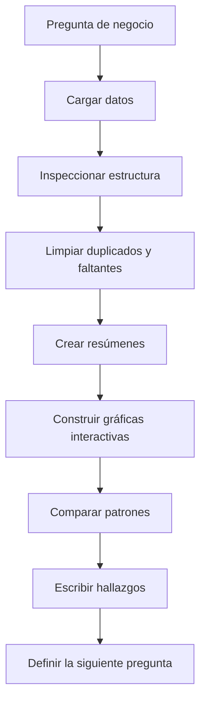
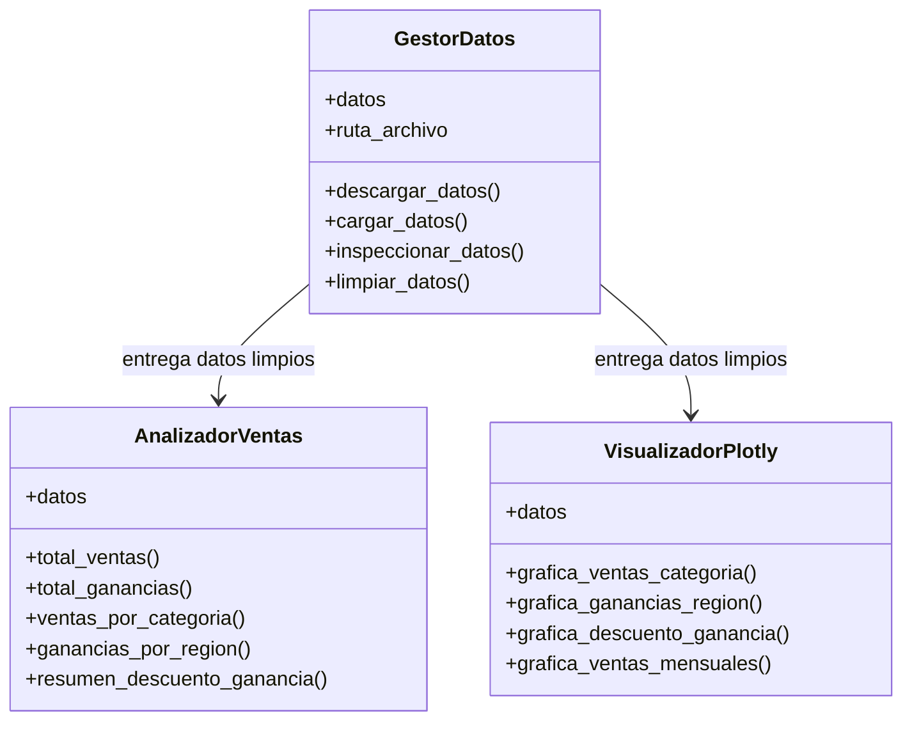
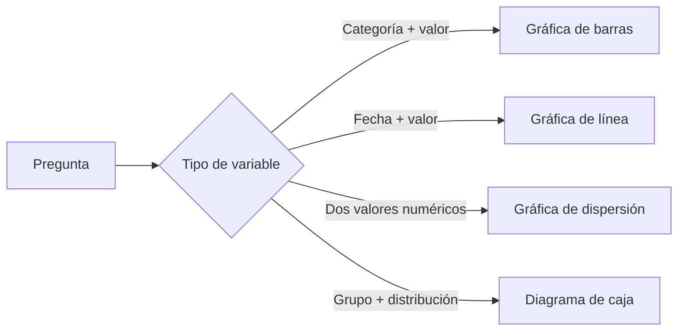

# Sesión 06 · Plotly, EDA y proyecto Supermart

Esta sesión conecta el análisis exploratorio de datos con un proyecto organizado en Python. El contexto de trabajo es el dataset **Supermart Grocery Sales** y el repositorio del proyecto:

[https://github.com/DIALVEBE/supermart-poo](https://github.com/DIALVEBE/supermart-poo)

El objetivo no es solamente crear gráficas. El objetivo es formular preguntas claras, preparar datos confiables, construir visualizaciones interactivas con Plotly y explicar hallazgos de forma comprensible.

<div class="callout callout-primary" markdown="1">

**Resultado de la sesión:** al finalizar, deberías poder leer la estructura del proyecto Supermart, ejecutar un flujo de EDA, construir gráficas interactivas y conectar esas gráficas con conclusiones analíticas breves.

</div>

## Objetivos de Aprendizaje

- Comprender el papel del EDA antes de construir conclusiones.
- Usar Plotly Express para crear gráficas interactivas.
- Comparar ventas, ganancias, descuentos, categorías, regiones y fechas.
- Separar responsabilidades de carga, análisis y visualización de datos.
- Interpretar gráficas con evidencia, no con suposiciones a partir de valores aislados.

## Proyecto de Trabajo

La sesión usa un repositorio público como base:

```bash
git clone https://github.com/DIALVEBE/supermart-poo.git
cd supermart-poo
```

Si el repositorio incluye un archivo `README.md`, léelo primero y sigue sus instrucciones de entorno. El trabajo esperado con datos usa estas bibliotecas de Python:

```bash
python -m pip install pandas plotly kagglehub
```

Si usas `uv`, la instalación equivalente es:

```bash
uv add pandas plotly kagglehub
```

## Contexto del Dataset

El proyecto trabaja con **Supermart Grocery Sales - Retail Analytics Dataset**, un dataset de ventas minoristas disponible en Kaggle. Algunas columnas útiles para esta sesión son:

| Columna | Por qué importa |
|---|---|
| `Category` | Permite comparar grupos de productos. |
| `Sub Category` | Da más detalle dentro de cada categoría. |
| `Region` | Permite comparar desempeño geográfico. |
| `Order Date` | Habilita análisis temporal. |
| `Sales` | Mide volumen de ingresos. |
| `Discount` | Ayuda a evaluar reducciones de precio. |
| `Profit` | Mide el resultado financiero. |

La primera decisión analítica es enfocarse en un grupo manejable de variables. Más columnas no producen automáticamente un mejor análisis.

## Flujo de EDA

El análisis exploratorio de datos avanza desde el contexto hacia la evidencia. Un flujo útil es:



Cada gráfica debe responder una pregunta. Si una gráfica no apoya una pregunta, probablemente es decoración.

## Preguntas para el Análisis

Usa el proyecto para responder preguntas como:

1. ¿Cuál es el valor total de ventas?
2. ¿Cuál es la ganancia total?
3. ¿Qué categoría vende más?
4. ¿Qué categoría genera más ganancia?
5. ¿Qué región tiene mayores ventas?
6. ¿Qué región tiene mayores ganancias?
7. ¿Existe una relación visible entre descuentos y ganancias?
8. ¿Las ventas o las ganancias cambian en el tiempo?

Estas preguntas son intencionalmente simples. Un buen EDA empieza con preguntas simples y luego las refina.

## Estructura Sugerida del Proyecto

El proyecto Supermart puede organizarse con responsabilidades claras:



Esta separación hace que el código sea más fácil de leer. El gestor prepara el dataset, el analizador calcula resultados y el visualizador comunica patrones.

## Cargar y Preparar los Datos

Un paso mínimo de carga puede verse así:

```python
import kagglehub
import pandas as pd
from pathlib import Path

dataset_path = kagglehub.dataset_download(
    "mohamedharris/supermart-grocery-sales-retail-analytics-dataset"
)

csv_path = Path(dataset_path) / "Supermart Grocery Sales - Retail Analytics Dataset.csv"
df = pd.read_csv(csv_path)

df.head()
```

Antes de graficar, inspecciona los datos:

```python
df.info()
df.describe()
df.isna().sum()
df.duplicated().sum()
```

Limpia solamente lo que entiendes:

```python
df = df.drop_duplicates()
df["Order Date"] = pd.to_datetime(df["Order Date"], errors="coerce")
```

## Crear Tablas de Resumen

Las gráficas de Plotly son más claras cuando los datos ya están resumidos.

```python
ventas_por_categoria = (
    df.groupby("Category", as_index=False)["Sales"]
    .sum()
    .sort_values("Sales", ascending=False)
)

ganancias_por_region = (
    df.groupby("Region", as_index=False)["Profit"]
    .sum()
    .sort_values("Profit", ascending=False)
)

ventas_mensuales = (
    df.assign(mes=df["Order Date"].dt.to_period("M").dt.to_timestamp())
    .groupby("mes", as_index=False)["Sales"]
    .sum()
)
```

La opción `as_index=False` conserva el resultado como una tabla normal. Ese formato funciona de forma natural con Plotly Express.

## Bases de Plotly Express

Plotly Express es una interfaz de alto nivel para crear gráficas interactivas.

```python
import plotly.express as px

fig = px.bar(
    ventas_por_categoria,
    x="Category",
    y="Sales",
    title="Ventas por categoría",
    text_auto=".2s"
)

fig.update_layout(
    template="plotly_dark",
    xaxis_title="Categoría",
    yaxis_title="Ventas"
)

fig.show()
```

Las gráficas interactivas permiten pasar el cursor, hacer zoom, filtrar y leer los datos con más detalle.

## Guía de Selección de Gráficas

Diferentes preguntas necesitan diferentes gráficas.

| Pregunta | Gráfica sugerida | Razón |
|---|---|---|
| ¿Qué categoría vende más? | Gráfica de barras | Compara cantidades entre grupos. |
| ¿Qué región tiene más ganancia? | Gráfica de barras | Ordena regiones según un valor numérico. |
| ¿Los descuentos se relacionan con la ganancia? | Gráfica de dispersión | Compara dos variables numéricas. |
| ¿Cómo cambian las ventas en el tiempo? | Gráfica de línea | Muestra movimiento a través de fechas. |
| ¿Cómo varía la ganancia dentro de cada región? | Diagrama de caja | Muestra distribución y valores atípicos. |



## Ventas por Categoría

Usa esta gráfica para identificar la categoría con mayor volumen de ventas.

```python
fig = px.bar(
    ventas_por_categoria,
    x="Category",
    y="Sales",
    color="Category",
    title="Ventas por categoría",
    text_auto=".2s"
)

fig.update_layout(template="plotly_dark", showlegend=False)
fig.show()
```

Guía de interpretación:

- Identifica la categoría con la barra más alta.
- Compara el primer y segundo lugar.
- Evita decir que una categoría es "mejor" si la ganancia no respalda esa conclusión.

## Ganancia por Región

Ventas y ganancias no son lo mismo. Una región puede vender mucho y aun así producir menor ganancia.

```python
fig = px.bar(
    ganancias_por_region,
    x="Region",
    y="Profit",
    color="Profit",
    color_continuous_scale="Tealrose",
    title="Ganancia por región",
    text_auto=".2s"
)

fig.update_layout(template="plotly_dark")
fig.show()
```

Pregunta:

- ¿Qué región tiene la mayor ganancia?
- ¿Las diferencias son grandes o pequeñas?
- ¿El orden coincide con el de ventas?

## Descuento y Ganancia

La gráfica de dispersión ayuda a inspeccionar si mayores descuentos se asocian con menor o mayor ganancia.

```python
fig = px.scatter(
    df,
    x="Discount",
    y="Profit",
    color="Category",
    hover_data=["Region", "Sales"],
    title="Descuento vs ganancia"
)

fig.update_layout(template="plotly_dark")
fig.show()
```

Observa:

- Puntos con alto descuento y ganancia negativa.
- Categorías que se concentran en una zona específica.
- Valores extremos que merecen revisión.

## Ventas en el Tiempo

El análisis temporal ayuda a detectar crecimiento, caídas y comportamientos estacionales.

```python
fig = px.line(
    ventas_mensuales,
    x="mes",
    y="Sales",
    markers=True,
    title="Ventas mensuales"
)

fig.update_layout(
    template="plotly_dark",
    xaxis_title="Mes",
    yaxis_title="Ventas"
)

fig.show()
```

No sobreinterpretes un pico aislado. Revisa si el patrón se repite o si pudo ser causado por pocos pedidos grandes.

## Distribución de Ganancias por Región

Un diagrama de caja muestra más que un total. Muestra cómo se distribuyen los valores dentro de cada grupo.

```python
fig = px.box(
    df,
    x="Region",
    y="Profit",
    color="Region",
    points="outliers",
    title="Distribución de ganancias por región"
)

fig.update_layout(template="plotly_dark", showlegend=False)
fig.show()
```

Úsalo para discutir:

- ¿Qué región tiene mayor dispersión?
- ¿Qué región tiene muchos pedidos con baja ganancia o ganancia negativa?
- ¿Qué valores atípicos necesitan inspección?

## De Gráfica a Hallazgo

Un hallazgo debe conectar evidencia con interpretación.

Declaración débil:

> La gráfica está interesante.

Mejor declaración:

> La Categoría A tiene las mayores ventas, pero su ganancia debe compararse con la Categoría B antes de concluir que es la categoría más fuerte.

Usa esta estructura:

```text
Pregunta:
Evidencia:
Interpretación:
Limitación:
Siguiente pregunta:
```

Ejemplo:

```text
Pregunta: ¿Qué región genera más ganancia?
Evidencia: La región con la barra más alta en la gráfica de ganancias es West.
Interpretación: West parece ser la región más fuerte por ganancia.
Limitación: Esto no explica si el resultado viene de muchos pedidos o de pocos pedidos grandes.
Siguiente pregunta: ¿Cuántos pedidos tiene cada región?
```

## Actividad Final

Abre el repositorio y produce un reporte corto de EDA con:

1. Ventas totales.
2. Ganancia total.
3. Gráfica de ventas por categoría.
4. Gráfica de ganancia por región.
5. Gráfica de descuento vs ganancia.
6. Gráfica de ventas mensuales.
7. Cuatro hallazgos escritos.
8. Una limitación del análisis.
9. Una siguiente pregunta para análisis futuro.

<div class="final-banner" markdown="1">

El valor del EDA no está en la cantidad de gráficas. Está en la calidad de las preguntas, la evidencia y las decisiones que vienen después.

</div>
